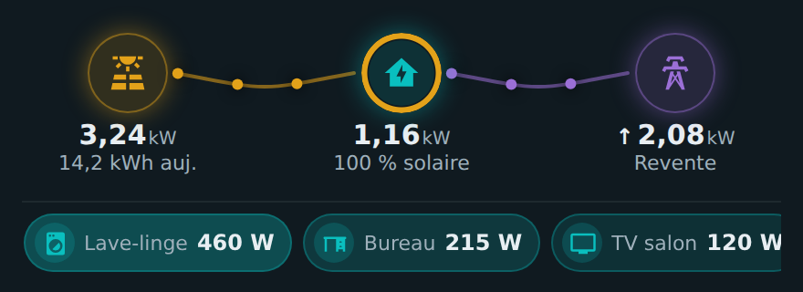
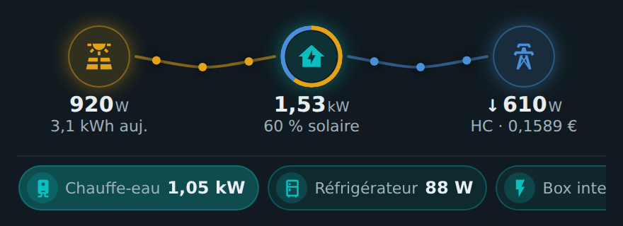
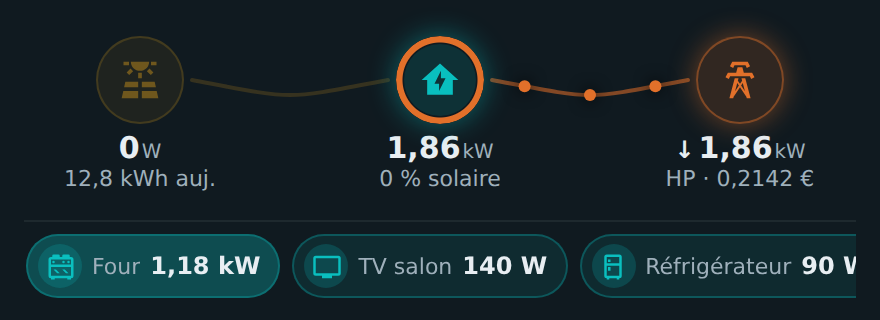
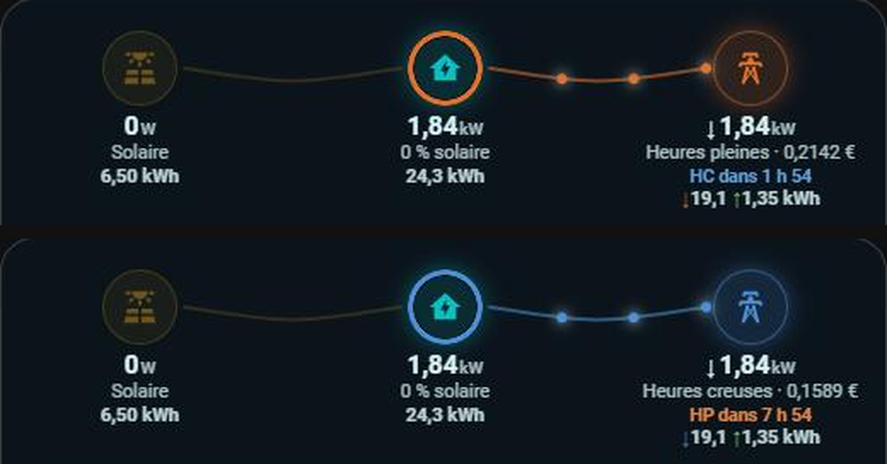

# ⚡ HOLM Power Flow Card

[](https://hacs.xyz/)


[🇫🇷 Français](README.md) · 🇬🇧 English

**Where is the house's electricity coming from, right now? Sun, grid, export: it all fits on one line.**

HOLM Power Flow Card shows the **real-time power flow** between your solar panels, the house and the grid, in a **compact, horizontal** card. Animated dots travel along each link, faster or slower depending on the power; the ring around the house shows the **solar share** of what you consume; and the **active devices** are listed right below.

> ✨ **Zero YAML.** The card reads the sensors of your **Energy dashboard**. Add it from the card picker and you're done; every setting is in the visual editor.

### At a glance

- ☀️ → 🏠 ⇄ 🗼 **Three nodes, one line**: solar production, house consumption, grid import or export.
- 🟠 **Animated dots** whose speed follows the power (in steps, to stay smooth).
- 🍩 **Solar ring** around the house: the share of your consumption covered by the sun (“60% solar”).
- ↑ **Export**: measured if you have a sensor, otherwise **estimated** from the exported energy (marked with ≈).
- 💶 **Off-peak / peak hours**: current period and kWh price, as a colour or spelled out, plus a **countdown** to the next change. With [HOLM HP/HC](https://github.com/kaaribou/holm-tarif), it's automatic.
- 🔌 **Active devices**: the Energy dashboard devices currently drawing power, sorted by power, with an automatically chosen icon (washing machine, oven, water heater, TV, air conditioning…).
- 🧮 **Today's totals** under the nodes: kWh imported ↓ and exported ↑, produced by the sun, consumed by the house.
- 📈 **Charts on tap**: tap a node or a device to open its power chart (6 h, 24 h, 48 h, 7 d or custom dates).
- 🎨 Custom colours, optional card frame, adjustable link curvature.
- 🌍 **8 languages**: English, French, German, Spanish, Italian, Dutch, Portuguese and Polish.

| Full sun (export) | Sun + grid in off-peak hours | Evening, peak hours |
|---|---|---|
|  |  |  |

*Screenshots in French — the card follows the language of your Home Assistant profile.*

---

### 🆕 What's new in 1.3.0

- 🌍 **The card speaks 8 languages**: English, French, German, Spanish, Italian, Dutch, Portuguese and Polish, charts and editor included. It follows the language of your Home Assistant profile (English if your language isn't translated yet); the `language` option lets you force one. Numbers and dates follow the language too.

### What's new in 1.2.0

#### 💶 Off-peak / peak hours with HOLM HP/HC, and the countdown

If the [HOLM HP/HC](https://github.com/kaaribou/holm-tarif) integration is installed, the card finds it on its own (`binary_sensor.heures_creuses`): no need to set a tariff or an off-peak price.

- **current period** and **kWh price** under the grid;
- **countdown** to the next change: “Off-peak in 1 h 54”, “Peak in 7 h 54” (`show_countdown` option);
- **display of your choice** (`tariff_display`): grid colour (blue off-peak, orange peak), an “Off-peak hours” / “Peak hours” label, or both.



Without HOLM HP/HC, nothing changes; the legacy method (`tariff_entity` + `hc_price`) is still available and takes priority when configured.

### What's new in 1.1.0

#### 🧮 Today's totals, on top of real time

Live power remains the main value; right below, each node now shows its **total since midnight**: **↓ imported** and **↑ exported** for the grid, **produced** for solar, **consumed** for the house. Totals come from the Energy dashboard statistics and refresh every 5 minutes (`show_totals` option to hide them).

#### 📈 A chart for every node and every device

Tap **Solar**, **Home**, **Grid** or an **active device** to open a chart panel:

- periods **6 h · 24 h · 48 h · 7 d** or **custom dates**;
- power curve, with **export below the axis** (in its own colour) for the grid;
- key figures: **now**, **min / max** (or import peak / export peak), **average**, and the period's **energy** (**imported / exported** for the grid);
- hover (or tap) the curve to read a value; ⓘ button for the Home Assistant more-info dialog.

## Requirements

- The Home Assistant **Energy dashboard** configured, ideally with the solar and grid **power sensors** (W).
- Otherwise, no problem: set your power sensors in the card editor (**Sensors** section).

---

## Installation

### With HACS (recommended)

1. HACS → ⋮ menu → **Custom repositories**.
2. Add `https://github.com/kaaribou/holm-power-flow-card`, category **Dashboard** (*Plugin*).
3. Search for **HOLM Power Flow Card** → **Download**.
4. Reload the page (Ctrl + F5).

### Manually

1. Copy `dist/holm-power-flow-card.js` to `config/www/community/holm-power-flow-card/`.
2. **Settings → Dashboards → ⋮ → Resources → Add**: `/local/community/holm-power-flow-card/holm-power-flow-card.js`, type **JavaScript module**.
3. Reload the page.

---

## Usage

Add the **HOLM – Compact power flow** card from the card picker.

```yaml
type: custom:holm-power-flow-card
```

### What the card computes

| Value | Source |
|---|---|
| Solar | solar power sensor (Energy dashboard or `solar_power`) |
| Grid | grid power sensor: positive = import, **negative = export** (Energy dashboard or `grid_power`) |
| Export | `export_power` if you have it, otherwise estimated from the energy exported over the last 10 minutes |
| Home | `home_power` if you have it, otherwise **solar + import − export** |
| Solar share | (solar − export) ÷ home |

---

## Options

| Option | Description | Default |
|---|---|---|
| `title` | Title above the flow | — |
| `language` | Card language: `fr`, `en`, `de`, `es`, `it`, `nl`, `pt`, `pl` | the profile's |
| `show_frame` | Show the card frame | `true` |
| `show_totals` | Today's totals under the nodes (imported / exported, produced, consumed) | `true` |
| `threshold` | Below this threshold (W), a link is considered inactive | `20` |
| `curve_factor` | Link curvature (0 = straight) | `1` |
| `solar_power` / `grid_power` | Power sensors (W or kW) | Energy dashboard |
| `export_power` / `home_power` | Exported / consumed power, if you have them | estimated |
| `export_energy` | Exported energy (kWh) used to estimate the export | Energy dashboard |
| `solar_label` / `home_label` / `grid_label` | Entity shown under a node (`none` for nothing) | today's production / solar share / tariff |
| `tariff_display` | Off-peak / peak hours: `color` (grid colour), `label` (“Off-peak hours” / “Peak hours”) or `both` | `color` |
| `show_countdown` | Countdown to the next off-peak / peak change | `true` |
| `hc_entity` | HOLM HP/HC off-peak `binary_sensor` | auto-detected |
| `tariff_entity` | Legacy method: current kWh tariff (takes priority if set) | — |
| `hc_price` | Legacy method: off-peak price, a number (`0.1589`) or an entity | — |
| `show_devices` | Show active devices | `true` |
| `show_device_names` | Show their names | `false` |
| `max_devices` / `device_threshold` | Max number of devices / minimum power (W) | `10` / `15` |
| `devices` | List of devices instead of the Energy dashboard ones (`entity`, `name`, `icon`, `color`) | Energy dashboard |
| `solar_color` / `home_color` / `grid_color` / `grid_hp_color` / `export_color` | Colours | gold / turquoise / blue / orange / purple |

### Off-peak / peak hours

**With [HOLM HP/HC](https://github.com/kaaribou/holm-tarif)** (recommended): nothing to configure, the period, price and countdown come from `binary_sensor.heures_creuses`.

```yaml
type: custom:holm-power-flow-card
tariff_display: both      # color, label or both
```

**Without HOLM HP/HC**, with a tariff sensor:

```yaml
type: custom:holm-power-flow-card
tariff_entity: sensor.current_tariff
hc_price: input_number.off_peak_price   # or a number: 0.1589
```

When the current tariff equals the off-peak price, the card shows “Off-peak”; otherwise “Peak”. If HOLM HP/HC is also installed, the countdown is still shown.

---

## FAQ / troubleshooting

| Problem | Solution |
|---|---|
| Everything is 0 | The Energy dashboard has no **power** sensor: set `solar_power` and `grid_power` in the editor. |
| Export doesn't show | Your grid sensor never goes below 0: add `export_power`, or let the card estimate it from the exported energy. |
| “≈” before the export | The export is estimated (no export power sensor). |
| No devices | Add devices (with a power sensor) in the Energy dashboard, or use the `devices` option. |
| The card is not in my language | Set `language` in the card, or open an issue to suggest a translation. |
| The new version doesn't show | Clear the cache (Ctrl + F5, or “Reload resources” in the mobile app). |

---

## Say thanks?

Like the card? You can buy me a beer 🍺

[](https://paypal.me/kaaribou)

---

## License

Code: **MIT** license — © kaaribou. See the [CHANGELOG](CHANGELOG.md) (in French).

Part of **HOLM — Home Orchestration & Living Management**: smart management and orchestration of the home.

Other projects: [Volets HOLM](https://github.com/kaaribou/volets-holm) · [Climat HOLM](https://github.com/kaaribou/climat-holm) · [Carburant HOLM](https://github.com/kaaribou/carburant-holm) · [HOLM Navbar Card](https://github.com/kaaribou/holm-navbar-card) · [HOLM Climate Card](https://github.com/kaaribou/climate-card-holm) · [HOLM Music Card](https://github.com/kaaribou/holm-music-card) · [HOLM Sentinel Card](https://github.com/kaaribou/holm-sentinel-card) · [HOLM Security Card](https://github.com/kaaribou/holm-security-card) · [HOLM Recordings Card](https://github.com/kaaribou/holm-recordings-card) · [HOLM Covers Card](https://github.com/kaaribou/holm-covers-card) · [HOLM Energy Cards](https://github.com/kaaribou/holm-energy-cards) · [HOLM Radiator Card](https://github.com/kaaribou/holm-radiator-card) · [HOLM Floor Card](https://github.com/kaaribou/holm-floor-card) · [HOLM Smoke Card](https://github.com/kaaribou/holm-smoke-card).
