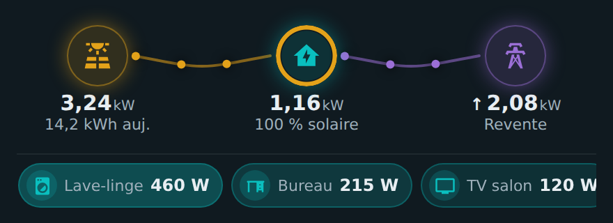
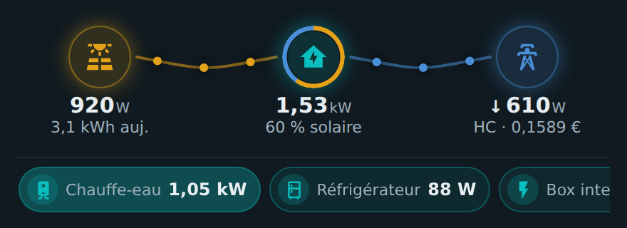
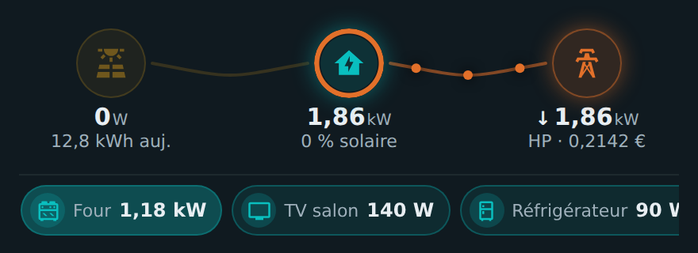
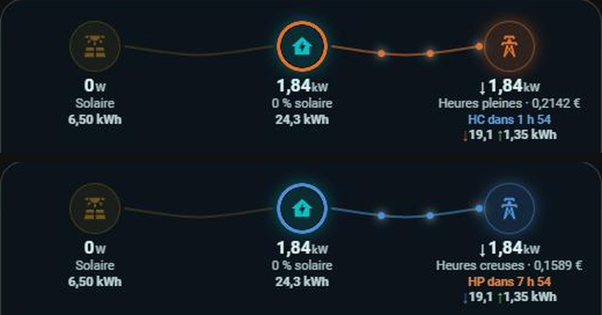

# ⚡ HOLM Power Flow Card

[](https://hacs.xyz/)


**D'où vient l'électricité de la maison, là, maintenant ? Soleil, réseau, revente : tout tient sur une ligne.**

HOLM Power Flow Card affiche le **flux de puissance en temps réel** entre vos panneaux solaires, la maison et le réseau, dans une carte **compacte et horizontale**. Des points animés circulent sur chaque liaison, plus ou moins vite selon la puissance ; l'anneau autour de la maison montre la **part solaire** de ce que vous consommez ; et les **appareils actifs** s'affichent juste en dessous.

> ✨ **Zéro YAML.** La carte lit les capteurs de votre **tableau de bord Énergie**. On l'ajoute depuis le sélecteur de cartes, c'est tout ; chaque réglage se fait dans l'éditeur visuel.

### En bref

- ☀️ → 🏠 ⇄ 🗼 **Trois nœuds, une ligne** : production solaire, consommation de la maison, achat ou revente sur le réseau.
- 🟠 **Points animés** dont la vitesse suit la puissance (par paliers, pour rester fluide).
- 🍩 **Anneau solaire** autour de la maison : la part de votre consommation couverte par le soleil (« 60 % solaire »).
- ↑ **Revente** : mesurée si vous avez un capteur, sinon **estimée** à partir de l'énergie revendue (signalée par ≈).
- 💶 **Heures creuses / pleines** : période et prix du kWh en cours, en couleur ou en toutes lettres, et le **décompte** jusqu'au prochain changement. Avec [HOLM HP/HC](https://github.com/kaaribou/holm-tarif), c'est automatique.
- 🔌 **Appareils actifs** : les appareils du tableau Énergie qui consomment, triés par puissance, avec une icône choisie automatiquement (lave-linge, four, chauffe-eau, TV, clim…).
- 🧮 **Totaux du jour** sous les nœuds : kWh achetés ↓ et revendus ↑ au réseau, produits par le solaire, consommés par la maison.
- 📈 **Graphiques au toucher** : un toucher sur un nœud ou un appareil ouvre son graphique de puissance (6 h, 24 h, 48 h, 7 j ou dates au choix).
- 🎨 Couleurs personnalisables, cadre de carte facultatif, courbure des liaisons réglable.

| En plein soleil (revente) | Soleil + réseau en heures creuses | Le soir, heures pleines |
|---|---|---|
|  |  |  |

---

### 🆕 Nouveautés de la 1.2.0

#### 💶 Heures creuses / pleines avec HOLM HP/HC, et le décompte

Si l'intégration [HOLM HP/HC](https://github.com/kaaribou/holm-tarif) est installée, la carte la trouve toute seule (`binary_sensor.heures_creuses`) : plus besoin de renseigner un tarif ni un prix HC.

- **période en cours** et **prix du kWh** sous le réseau ;
- **décompte** jusqu'au prochain changement : « HC dans 1 h 54 », « HP dans 7 h 54 » (option `show_countdown`) ;
- **affichage au choix** (`tariff_display`) : couleur du réseau (bleu en HC, orange en HP), repère « Heures creuses » / « Heures pleines », ou les deux.



Sans HOLM HP/HC, rien ne change ; l'ancienne méthode (`tariff_entity` + `hc_price`) reste disponible et reste prioritaire si elle est configurée.

### Nouveautés de la 1.1.0

#### 🧮 Les totaux du jour, en plus du temps réel

La puissance en direct reste la valeur principale ; juste en dessous, chaque nœud affiche maintenant son **total depuis minuit** : **↓ acheté** et **↑ revendu** pour le réseau, **produit** pour le solaire, **consommé** pour la maison. Les totaux viennent des statistiques du tableau Énergie et se mettent à jour toutes les 5 minutes (option `show_totals` pour les masquer).

#### 📈 Un graphique pour chaque nœud et chaque appareil

Un toucher sur **Solaire**, **Maison**, **Réseau** ou un **appareil actif** ouvre un panneau graphique :

- périodes **6 h · 24 h · 48 h · 7 j** ou **dates au choix** ;
- courbe de puissance, avec la **revente sous l'axe** (dans sa couleur) pour le réseau ;
- chiffres clés : **actuel**, **min / max** (ou pic d'achat / pic de revente), **moyenne**, et l'**énergie** de la période (**acheté / revendu** pour le réseau) ;
- survol (ou toucher) de la courbe pour lire une valeur ; bouton ⓘ pour la fenêtre d'informations de Home Assistant.

## Prérequis

- Le **tableau de bord Énergie** de Home Assistant configuré, idéalement avec les **capteurs de puissance** (W) du solaire et du réseau.
- Sinon, pas de souci : indiquez vos capteurs de puissance dans l'éditeur de la carte (rubrique **Capteurs**).

---

## Installation

### Avec HACS (recommandé)

1. HACS → menu ⋮ → **Dépôts personnalisés**.
2. Ajoutez `https://github.com/kaaribou/holm-power-flow-card`, catégorie **Tableau de bord** (*Dashboard / Plugin*).
3. Recherchez **HOLM Power Flow Card** → **Télécharger**.
4. Rechargez la page (Ctrl + F5).

### Manuellement

1. Copiez `dist/holm-power-flow-card.js` dans `config/www/community/holm-power-flow-card/`.
2. **Paramètres → Tableaux de bord → ⋮ → Ressources → Ajouter** : `/local/community/holm-power-flow-card/holm-power-flow-card.js`, type **Module JavaScript**.
3. Rechargez la page.

---

## Utilisation

Ajoutez la carte **HOLM – Flux de puissance compact** depuis le sélecteur de cartes.

```yaml
type: custom:holm-power-flow-card
```

### Ce que la carte calcule

| Valeur | Source |
|---|---|
| Solaire | capteur de puissance solaire (tableau Énergie ou `solar_power`) |
| Réseau | capteur de puissance réseau : positif = achat, **négatif = revente** (tableau Énergie ou `grid_power`) |
| Revente | `export_power` si vous l'avez, sinon estimée à partir de l'énergie revendue des 10 dernières minutes |
| Maison | `home_power` si vous l'avez, sinon **solaire + achat − revente** |
| Part solaire | (solaire − revente) ÷ maison |

---

## Options

| Option | Description | Par défaut |
|---|---|---|
| `title` | Titre au-dessus du flux | — |
| `show_frame` | Afficher le cadre de la carte | `true` |
| `show_totals` | Totaux du jour sous les nœuds (acheté / revendu, produit, consommé) | `true` |
| `threshold` | En dessous de ce seuil (W), une liaison est considérée inactive | `20` |
| `curve_factor` | Courbure des liaisons (0 = droites) | `1` |
| `solar_power` / `grid_power` | Capteurs de puissance (W ou kW) | tableau Énergie |
| `export_power` / `home_power` | Puissance revendue / consommée, si vous les avez | estimées |
| `export_energy` | Énergie revendue (kWh) pour estimer la revente | tableau Énergie |
| `solar_label` / `home_label` / `grid_label` | Entité à afficher sous un nœud (`none` pour rien) | production du jour / part solaire / tarif |
| `tariff_display` | Heures creuses / pleines : `color` (couleur du réseau), `label` (« Heures creuses » / « Heures pleines ») ou `both` | `color` |
| `show_countdown` | Décompte jusqu'au prochain changement HC / HP | `true` |
| `hc_entity` | `binary_sensor` des heures creuses de HOLM HP/HC | détecté automatiquement |
| `tariff_entity` | Ancienne méthode : tarif du kWh en cours (prioritaire si renseigné) | — |
| `hc_price` | Ancienne méthode : prix des heures creuses, un nombre (`0.1589`) ou une entité | — |
| `show_devices` | Afficher les appareils actifs | `true` |
| `show_device_names` | Afficher leur nom | `false` |
| `max_devices` / `device_threshold` | Nombre maximum d'appareils / puissance minimale (W) | `10` / `15` |
| `devices` | Liste d'appareils à la place de ceux du tableau Énergie (`entity`, `name`, `icon`, `color`) | tableau Énergie |
| `solar_color` / `home_color` / `grid_color` / `grid_hp_color` / `export_color` | Couleurs | or / turquoise / bleu / orange / violet |

### Heures creuses / pleines

**Avec [HOLM HP/HC](https://github.com/kaaribou/holm-tarif)** (recommandé) : rien à configurer, la période, le prix et le décompte viennent de `binary_sensor.heures_creuses`.

```yaml
type: custom:holm-power-flow-card
tariff_display: both      # color, label ou both
```

**Sans HOLM HP/HC**, avec un capteur de tarif :

```yaml
type: custom:holm-power-flow-card
tariff_entity: sensor.tarif_actuel
hc_price: input_number.prix_heures_creuses   # ou un nombre : 0.1589
```

Quand le tarif en cours est égal au prix des heures creuses, la carte affiche « HC » ; sinon « HP ». Si HOLM HP/HC est aussi installé, le décompte s'affiche quand même.

---

## FAQ / dépannage

| Problème | Solution |
|---|---|
| Tout est à 0 | Le tableau Énergie n'a pas de capteur de **puissance** : renseignez `solar_power` et `grid_power` dans l'éditeur. |
| La revente n'apparaît pas | Votre capteur réseau ne descend pas sous 0 : ajoutez `export_power`, ou laissez la carte l'estimer via l'énergie revendue. |
| « ≈ » devant la revente | La revente est estimée (pas de capteur de puissance de revente). |
| Pas d'appareils | Ajoutez des appareils (avec capteur de puissance) dans le tableau Énergie, ou utilisez l'option `devices`. |
| La nouvelle version ne s'affiche pas | Videz le cache (Ctrl + F5, ou « Recharger les ressources » dans l'application mobile). |

---

## Un petit merci ?

La carte vous plaît ? Vous pouvez m'offrir une bière 🍺

[](https://paypal.me/kaaribou)

---

## Licence

Code : licence **MIT** — © kaaribou. Voir le [CHANGELOG](CHANGELOG.md).

Fait partie de **HOLM — Home Orchestration & Living Management** : la gestion et l'orchestration intelligente de la maison.

Les autres projets : [Volets HOLM](https://github.com/kaaribou/volets-holm) · [Climat HOLM](https://github.com/kaaribou/climat-holm) · [Carburant HOLM](https://github.com/kaaribou/carburant-holm) · [Commandes à la maison HOLM](https://github.com/kaaribou/commandes-holm) · [HOLM Navbar Card](https://github.com/kaaribou/holm-navbar-card) · [HOLM Climate Card](https://github.com/kaaribou/climate-card-holm) · [HOLM Music Card](https://github.com/kaaribou/holm-music-card) · [HOLM Sentinel Card](https://github.com/kaaribou/holm-sentinel-card) · [HOLM Security Card](https://github.com/kaaribou/holm-security-card) · [HOLM Recordings Card](https://github.com/kaaribou/holm-recordings-card) · [HOLM Covers Card](https://github.com/kaaribou/holm-covers-card) · [HOLM Energy Cards](https://github.com/kaaribou/holm-energy-cards) · [HOLM Radiator Card](https://github.com/kaaribou/holm-radiator-card) · [HOLM Floor Card](https://github.com/kaaribou/holm-floor-card) · [HOLM Smoke Card](https://github.com/kaaribou/holm-smoke-card) · [HOLM BG Card](https://github.com/kaaribou/holm-bg-card).
